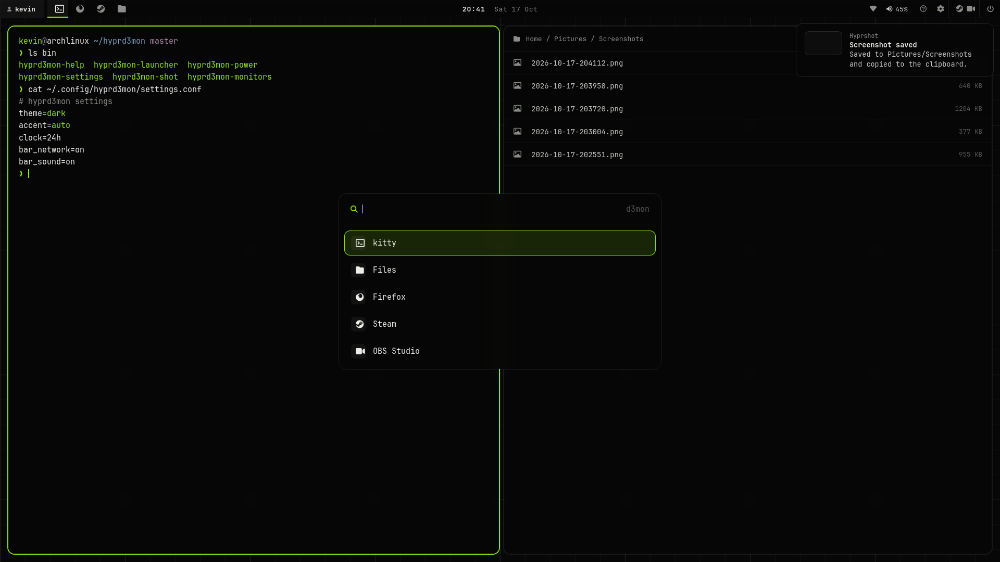
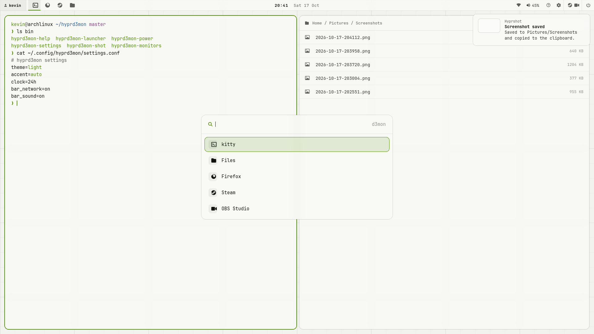

# hyprd3mon

A lightweight Hyprland desktop for Arch Linux in the **d3mon** theme:
frosted-glass windows over a grid wallpaper, one accent colour, and
both dark and light themes.




<sub>Design mocks (HTML renders), not live screenshots yet.</sub>

## What you get

- **Hyprland 0.56** (Lua config): blur, rounded glass windows,
  accent focus border, smooth fades.
- **Top bar** (Waybar), full width: your username (opens the
  launcher), open apps, time and date, network, sound, keybind help,
  settings, tray (background apps), power menu.
- **Launcher** (Rofi) in the middle of the screen, plus a power menu:
  lock, log out, restart, shut down.
- **Lock screen** (Hyprlock): avatar, user name, password field.
- **Screenshots** (Hyprshot): window, region, one monitor or all
  monitors. Each one is saved *and* copied to the clipboard, ready to
  paste into Discord or a website.
- **Network menu**: click the bar's network icon for a Wi-Fi list
  (click a network to join; a password box pops up), Wi-Fi on/off,
  disconnect/forget and VPN on/off. Right-click opens the full
  NetworkManager editor.
- **Settings menu**: dark/light theme, accent colour, keybinds, which
  bar items to show, 12/24h clock, monitor layout.
- **Apps**: Kitty, Nautilus (with GTK file dialogs for browsers),
  Firefox, OBS Studio with the browser source plugin and obs-vkcapture
  for game capture, Steam (its client, friends list and other windows
  all float).
- Works on one screen (a laptop) or on two screens stacked one above
  the other.

## Install

```sh
git clone https://github.com/uhd3mon/hyprd3mon.git
cd hyprd3mon
./install.sh            # dry run: shows every action
./install.sh --apply    # install packages + files
```

Options: `--skip-steam`, `--skip-aur` (obs-vkcapture),
`--skip-packages` (configs only).

- Steam needs `[multilib]` enabled in `/etc/pacman.conf`.
- obs-vkcapture comes from the AUR, so it needs `yay`.

Then log out and pick **Hyprland** on the login screen.

Re-running is safe. Unchanged files are skipped. Changed files are
backed up to `~/.local/state/hyprd3mon/backup/<timestamp>/` first.
Your settings, keybinds and monitor layout are never overwritten.

If you also use another desktop (e.g. KDE) on the same account, it
shares some of this:
- `~/.config/kitty/kitty.conf` is replaced. The old one is backed up.
- The GTK theme and icon settings (gsettings) are changed.
- Nautilus becomes the default folder app.

## Keys

`SUPER` is the Windows key. Press **SUPER + F1** or the **?** in the
bar for the full list. Change any of them under Settings → Keybinds.

| Keys | Action |
| --- | --- |
| SUPER + Space (or R) | App launcher |
| SUPER + Return | Kitty |
| SUPER + E | Nautilus |
| SUPER + B | Firefox |
| SUPER + Q | Close window |
| SUPER + V / F | Float / fullscreen |
| SUPER + L | Lock |
| SUPER + Escape | Power menu |
| SUPER + comma | Settings |
| SUPER + 1-0 | Workspace |
| SUPER + SHIFT + 1-0 | Move window to workspace |
| Print or SUPER+SHIFT+S | Screenshot a region |
| SUPER+Print or SUPER+SHIFT+W | Screenshot a window |
| SHIFT+Print or SUPER+SHIFT+M | Screenshot this monitor |
| CTRL+Print or SUPER+SHIFT+A | Screenshot all monitors |

## Two stacked monitors

By default, each extra screen is placed above the previous one. To
choose which one is the main screen, use Settings → Monitors, or run
this inside Hyprland:

```sh
hyprd3mon-monitors            # list screens
hyprd3mon-monitors DP-1 DP-2  # DP-1 in front, DP-2 above it
hyprd3mon-monitors single     # back to automatic
```

Workspaces 1-5 go on the main screen, 6-10 on the top one.

## Where things live

- `~/.config/hyprd3mon/settings.conf`: theme, accent, bar
- `~/.config/hyprd3mon/keybinds.conf`: your keybind changes
- `~/.config/hypr/monitors.lua`: monitor layout
- `~/.config/hypr/local.lua`: optional extra Hyprland settings

## Repo layout

- `install.sh`: the installer
- `configs/<app>/`: copied to `~/.config/<app>/`
- `bin/`: `hyprd3mon-*` commands, copied to `~/.local/bin/`
- `assets/`: wallpapers, theme palettes, avatar, Unbounded font (OFL)
- `docs/preview/`: design mocks

Contributors and agents: read [AGENTS.md](AGENTS.md) first.
